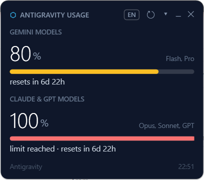
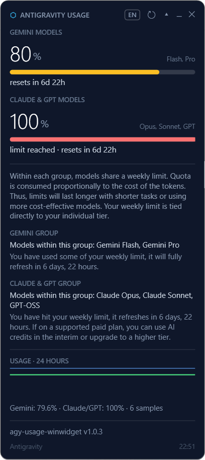

# agy-usage-winwidget

[](https://github.com/IberianSoldierPC/agy-usage-winwidget/releases)
[](https://github.com/IberianSoldierPC/agy-usage-winwidget/releases/latest)
[](LICENSE)


A tiny floating window + tray icon for Windows that shows your
[Google Antigravity](https://antigravity.google) weekly quota — the same numbers
as `/usage` inside the Antigravity CLI, refreshed automatically every two minutes.

<p align="center">
  
  &nbsp;&nbsp;
  
</p>

**English** · [Español](README.es.md)

> **Based on [Enhed/clawd-usage-winwidget](https://github.com/Enhed/clawd-usage-winwidget)**
> by [Venger Sergey](https://github.com/Enhed) — a wonderful Claude Code usage
> widget that inspired the architecture, UI design, and many patterns used here.
> Huge thanks for creating and open-sourcing it under the MIT license. 🧡

---

## Features

- 📊 **Two progress bars** — Gemini Models (Flash, Pro) and Claude & GPT Models
  (Opus, Sonnet, GPT-OSS), each with its own remaining percentage and reset
  countdown.
- 🎨 **Dynamic colours** — green → yellow → red as usage grows past configurable
  thresholds.
- ⬡ **Hexagonal tray icon** — shows the lowest remaining percentage at a glance.
- 📈 **History chart** — expand the details panel to see usage over the last 24
  hours as line graphs. The history is saved to disk, so it survives restarts.
- 🌐 **English & Spanish** — switch instantly with the **EN / ES** button in the
  header, or pick *Automatic* from the tray menu to follow your Windows language.
- 🔄 **Auto-refresh** — queries `agy -p "/usage"` every 2 minutes (configurable).
- 💾 **Persistent position** — remembers where you dragged the window.
- 🔍 **Mouse-wheel zoom** — scroll to scale the whole widget up or down.
- 🖥️ **No dependencies** — plain Windows PowerShell 5.1 + WPF, which ship with
  Windows. You only need the Antigravity CLI (`agy`) on your `PATH`.

## Install

**Requirements:** Windows 10/11 and the
[Antigravity CLI](https://antigravity.google) installed and logged in (`agy` on
`PATH`).

- **Option A (Recommended):** Download the [**latest release ZIP**](https://github.com/IberianSoldierPC/agy-usage-winwidget/releases/latest) and extract it anywhere.
- **Option B (Git):** Clone the repository:
  ```powershell
  git clone https://github.com/IberianSoldierPC/agy-usage-winwidget.git
  ```

Then double-click **`start-widget.vbs`** — the widget starts silently without a console window.

### Auto-start with Windows

Create a shortcut to `start-widget.vbs` and place it in your Startup folder:

```
Win+R → shell:startup → paste the shortcut
```

## Usage

| Action | Effect |
|--------|--------|
| **Drag the window** | Move it anywhere |
| **Mouse wheel** | Scale the widget (zoom in / out) |
| **🔄 Refresh** | Force an immediate data reload |
| **▾ / ▴ Toggle** | Expand / collapse the details panel |
| **— Minimize** | Hide to system tray |
| **✕ Close** | Exit the widget |
| **Left-click tray icon** | Show / hide the window |
| **ES / EN** | Switch the interface language instantly |
| **Right-click tray icon** | Context menu (Show, Refresh, Language, Exit) |

## Configuration

Edit `config.json` next to `widget.ps1`:

| Key | Default | Description |
|-----|---------|-------------|
| `refreshSeconds` | `10` | UI refresh interval (seconds) |
| `usageIntervalSeconds` | `120` | How often to query `agy /usage` |
| `expanded` | `false` | Whether the details panel starts open |
| `scale` | `1.35` | Window scale factor |
| `warnPercent` | `60` | Yellow threshold (% **used**) |
| `critPercent` | `85` | Red threshold (% **used**) |
| `showRemaining` | `false` | If `true`, shows % remaining instead of % used |
| `language` | `"es"` | UI language (`"es"`, `"en"`, or `"auto"`) |
| `opacity` | `1.0` | Window opacity (0.0–1.0) |
| `topmost` | `false` | Keep the window above all others |

## Data source

The widget runs:

```
agy -p "/usage" --output-format json
```

This is the same data shown by the `/usage` slash command inside Antigravity —
official quota numbers from the server. **No model call, no tokens spent.**

The JSON response includes one bucket per model group with
`remaining_fraction`, `reset_time`, and human-readable descriptions.

## Credits

This project is a fork / adaptation of
**[clawd-usage-winwidget](https://github.com/Enhed/clawd-usage-winwidget)** by
[Venger Sergey](https://github.com/Enhed), released under the
[MIT License](https://github.com/Enhed/clawd-usage-winwidget/blob/main/LICENSE).

The original widget tracks Claude Code usage; this version has been rewritten to
track Google Antigravity quota instead. The architectural patterns — WPF over
PowerShell, async usage probes, tray icon rendering, single-instance mutex,
config persistence, XAML-driven UI — are directly inspired by the original.

## License

[MIT](LICENSE) — same as the original project.
